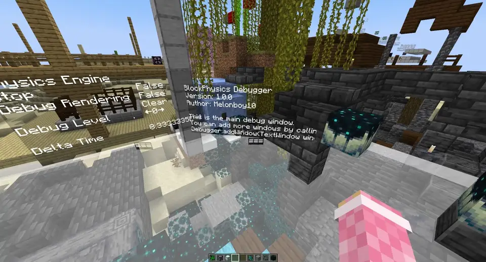
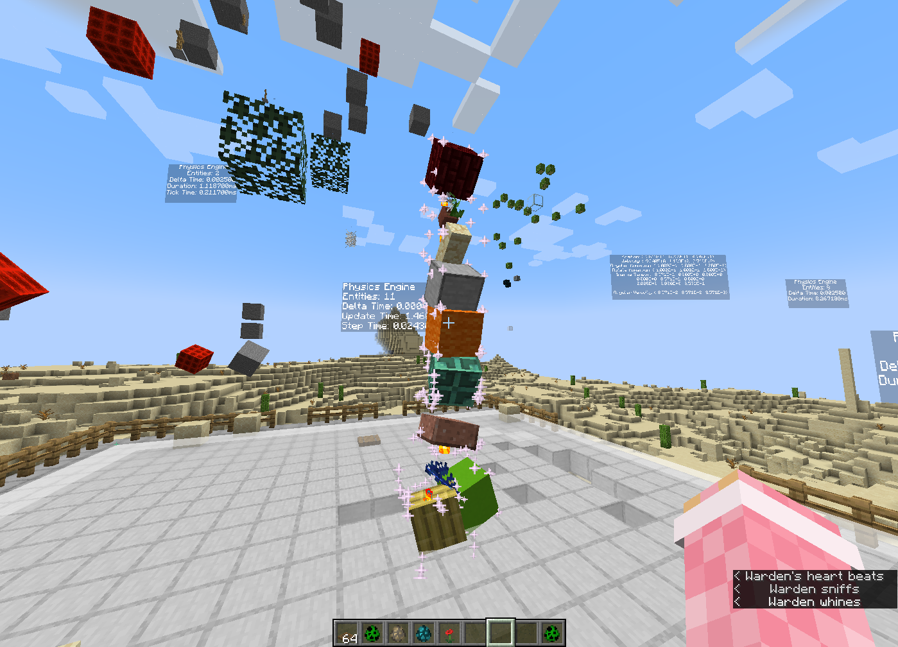
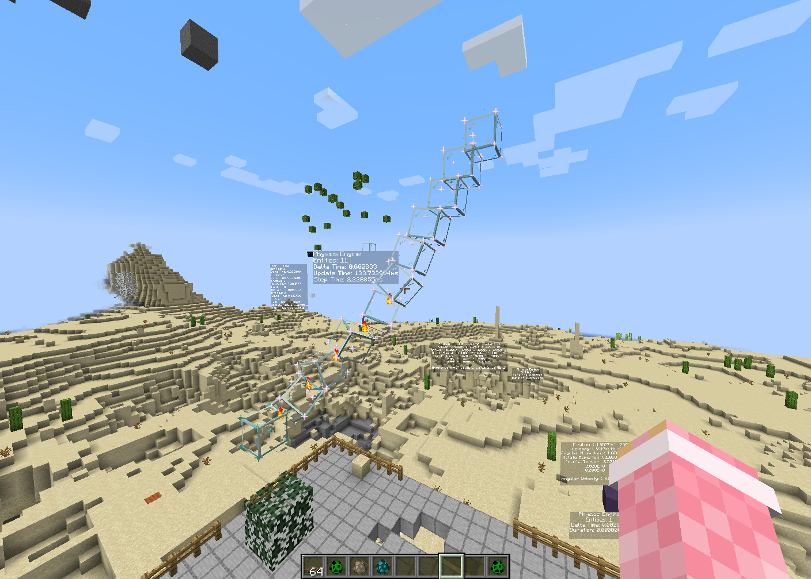

# BlockPhysics

Rigid-body physics plugin for Minecraft! Blocks are rendered as display entities and simulated with gravity, rotation, collision response, and friction. Everything is controlled with in-game commands.

### Fall test



[^ video](pictures/falltest.mp4).

### Screenshots

Physics blocks with particle outlines and in-world diagnostics:



Glass blocks with collision debugging visible:



## Features

- Spawn individual physics blocks using Minecraft block states and collision shapes.
- Create grids of blocks. Create emitters that shoot blocks continuously.
- Copy a selected region of the world into a solid display block rigid body.
- Add a stationary glass floor for collision experiments.
- Pause, resume, advance the simulation, and adjust gravity and the timestep.
- View collision and motion debugging information in-game.
- Pick up individual physics blocks through their interaction entities.

## Requirements

- **Paper 1.20.4**.
- **Java 17**, configured by the Gradle toolchain and compiler release target.
- **CommandAPI**, supplied separately at runtime. The project compiles against `commandapi-bukkit-core:9.3.0` with `compileOnly`; it is not bundled in the plugin JAR.
- The included **Gradle 8.1.1** wrapper for building.

## Build and setup

The build currently sends both `jar` and `reobfJar` outputs to my desktop Minecraft server directory, but you should change that before building on your machine. Edit the `jar` and `reobfJar` blocks in [build.gradle.kts](build.gradle.kts) to use your own destination or a project-local output directory, for example:

```kotlin
jar {
  destinationDirectory.set(layout.buildDirectory.dir("libs"))
}
reobfJar {
  outputJar.set(layout.buildDirectory.file("libs/${project.name}-${project.version}.jar"))
}
```

Then build from the project root:

```shell
./gradlew build
```

Put the runtime CommandAPI plugin and the BlockPhysics JAR in your server's `plugins` directory.

It currently requires a player to be online during plugin initialization. So, log in and run `reload confirm` to load the plugin.

## Things to try:

Once the plugin is loaded, stand in an open area and run:

```text
/physics summon minecraft:stone
/physics grid minecraft:slime_block 3
```

All commands run in-game as a player.

| Command                                       | Behavior                                                                                                                      |
|-----------------------------------------------|-------------------------------------------------------------------------------------------------------------------------------|
| `/physics summon [block] [active]`            | Spawns a block at your position. Without a block argument, chooses a random block material.                                   |
| `/physics grid [block] [width]`               | Spawns a square grid, defaulting to 5 by 5.                                                                                   |
| `/physics floor [scale]`                      | Creates a stationary floor, default scale `10`.                                                                               |
| `/physics emitter [rate] [facing] [block]`    | Creates a emitter. `facing=true` launches blocks on your look direction, otherwise up with random horizontal velocity.        |
| `/physics area <x1> <y1> <z1> <x2> <y2> <z2>` | Copies blocks in the region into a physics group at your position.                                                            |
| `/physics stop`                               | Pauses the simulation.                                                                                                        |
| `/physics start`                              | Resumes the simulation.                                                                                                       |
| `/physics step [steps]`                       | Runs the specified number of complete physics updates then pauses.                                                            |
| `/physics gravity <gravity>`                  | Sets gravity, initially `9.8`. `0` disables gravity.                                                                          |
| `/physics time <deltaTime>`                   | Sets the timestep used by each physics substep. Initial value: `1 / (20 × 60)` seconds.                                       |
| `/physics debug`                              | Toggles debug rendering.                                                                                                      |
| `/physics debug <level>`                      | Sets the debug level; choosing the current level also toggles rendering. Level `5` and above adds per-block text information. |
